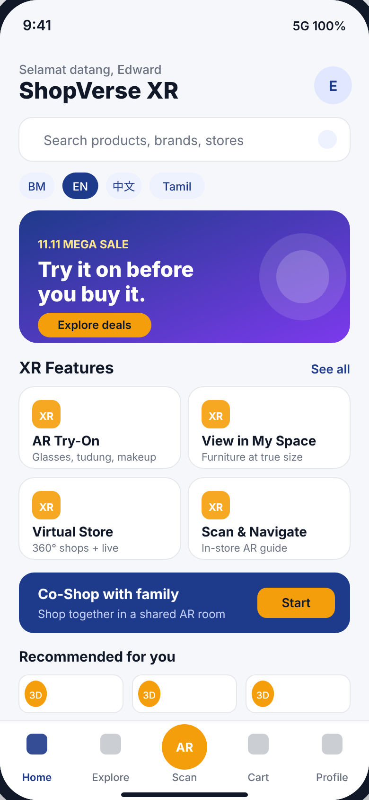

# ShopVerse XR – High-Fidelity Alpha Prototype

ShopVerse XR is an Extended Reality (AR/VR/MR) shopping app concept for Malaysian retail. It was built for ITS63504 Human Computer Interaction (Taylor's University).

**Live prototype:** open `index.html` in a browser, or view it on GitHub Pages once Pages is enabled.

## Five XR solutions
1. **AR Virtual Try-On + AI Size & Fit Advisor**: try on glasses, tudung, makeup and watches through the front camera.
2. **AR View in My Space**: place true-scale 3D furniture in your room.
3. **Virtual Store & Live Commerce**: a 360° / WebXR store with a live host.
4. **In-Store AR Scan & Navigate**: price, halal status and stock on scan, plus AR wayfinding.
5. **Co-Shopping Room & Smart Checkout**: a shared AR room and Malaysian payment methods (DuitNow, FPX, TNG eWallet).

## Screens
| # | Screen | Feature |
|---|--------|---------|
| 1 | Home | Entry to all features |
| 2 | AR Try-On | Solution 1 |
| 3 | View in My Space | Solution 2 |
| 4 | Virtual Store & Live | Solution 3 |
| 5 | Scan & Navigate | Solution 4 |
| 6 | Co-Shop & Checkout | Solution 5 |
| 7 | Order Confirmed | End of flow |

## Tech
Plain HTML, CSS and JavaScript with inline SVG screens. There are no dependencies. Tap buttons inside the phone to navigate, or tap an empty area to highlight the clickable spots.
